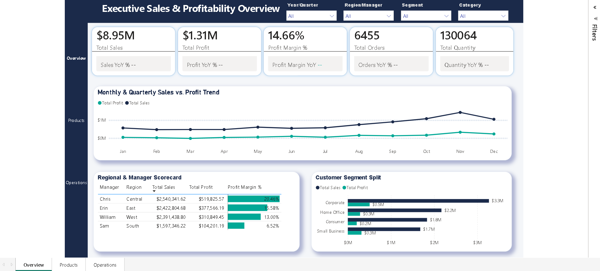
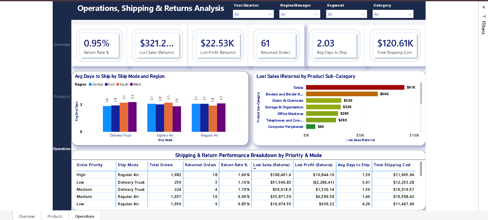
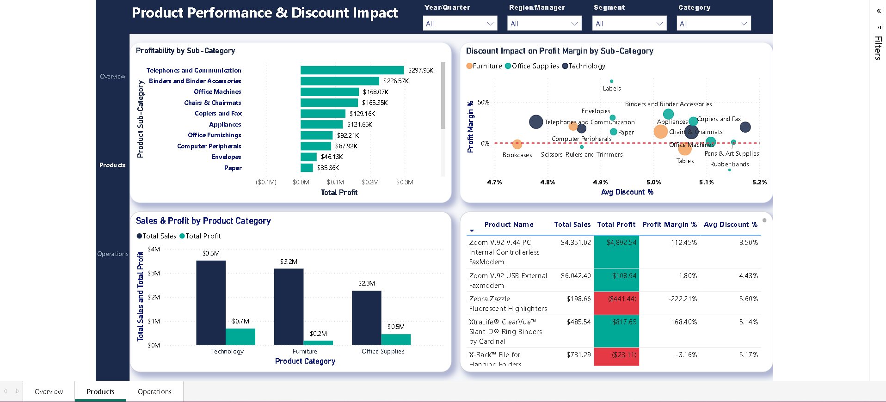

# Superstore Executive BI Dashboard

An interactive 3-page Power BI report analyzing sales profitability, product discounting impact, and shipping/return operations across a star-schema data model (`Orders`, `Returns`, `Users`, and a custom `Calendar` table).

## Pages & Visual Highlights

### 1. Executive Sales & Profitability Overview
- Headline KPI cards with YoY reference comparisons (`Total Sales`, `Total Profit`, `Profit Margin %`, `Total Orders`, `Total Quantity`).
- Monthly & quarterly sales vs. profit trendline, regional/manager performance scorecard with conditional formatting, and customer segment breakdown.

### 2. Product Performance & Discount Impact
- Sub-category profitability ranking with conditional color rules, discount vs. profit margin scatter analysis, category sales/profit comparison, and product-level performance table.

### 3. Operations, Shipping & Returns Analysis
- Operational KPIs (`Return Rate %`, `Lost Sales (Returns)`, `Lost Profit (Returns)`, `Returned Orders`, `Avg Days to Ship`, `Total Shipping Cost`).
- Shipping speed drill-down by mode/region, return loss analysis by sub-category, and an order priority/ship mode breakdown table.

## Data Model & Performance Optimization
- Star schema connecting `Orders` to `Calendar` (date intelligence), `Users` (regional managers), and `Returns` (return tracking).
- Trimmed unused columns and staging queries in Power Query to keep the model lightweight and responsive.

## Repository Contents
- `Superstore_Executive_Dashboard.pbix` — Full Power BI report, data model, and DAX measures.
- `Superstore_Executive_Dashboard.pdf` — Static 3-page export for quick viewing.
- `images/` — High-resolution screenshots of each report page.

- `DAX_Measures.md` — Complete formula reference and business explanations ([View Full DAX Measures Reference](DAX_Measures.md)).